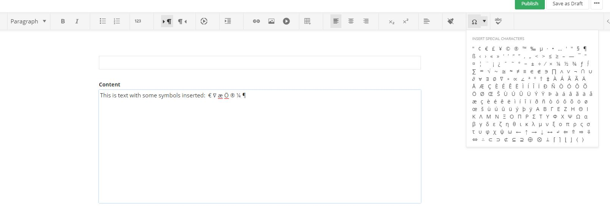

# Insert symbol

## Summary

This is an extension to the rich text editor in **AdminApp** that allows the user to insert a special character picked from a predefined list. The list is replaceable and could be modified to the needs of the user.

## Interactions

The popup with the symbol list dropdown popup is opened via a custom button from the editor's toolbar.

- click, Enter or Space: inserts the symbol
- arrow keys, Home and End: move the focus between the symbols
- Esc: closes the popup and returns the focus to the toolbar button
- symbol hover: displays a tooltip with the defined name of the symbol

## Symbol list source

The symbols that populate the list are defined in a JSON file that is imported by the extension. The file is generated by a script making use of the [https://dev.w3.org/html5/html-author/charref](https://dev.w3.org/html5/html-author/charref). There are two supplied files for the the symbol list: _symbol-list.json_ and _symbol-list-full.json_. The extension uses by default the _symbol-list.json_ which contains a subset of the fill symbol list.

## Changing the symbol source

Replacing or modifying the required file would change the contents of the insert symbol popup.

## Implementation

**InsertSymbolProvider**: a custom provider that is responsible for registering the tool. The tool itself is responsible for inserting the symbol into the editor.

The tool has a `popup` function instead of an `exec` function. When the tool is pressed, the toolbar opens a popup anchored to it and calls `popup(container, context)` with the popup element and a context that holds the editor and a `close()` function. The toolbar positions the popup and closes it on Esc, which returns the focus to the tool, or when the focus leaves the popup.

The popup is populated with a `<button type="button">` for each symbol via the **InsertSymbolGenerator** class. Its constructor argument is the JSON file that is used to populate the popup. Making changes to that file, or using another, would change the content of the tool dropdown popup. Each button is named after its symbol, so screen readers announce e.g. "euro sign".

The click and keydown listeners are attached when the popup is rendered and detached by the teardown function that `popup` returns, which the toolbar calls when the popup closes. On click the symbol is inserted with `editor.exec("insertHtml", { html })` at the selection the editor had before the popup opened, and the popup is closed with `context.close()`. The arrow, Home and End keys move the focus between the symbols.

### Added dependencies

No added dependencies	

## Example 

